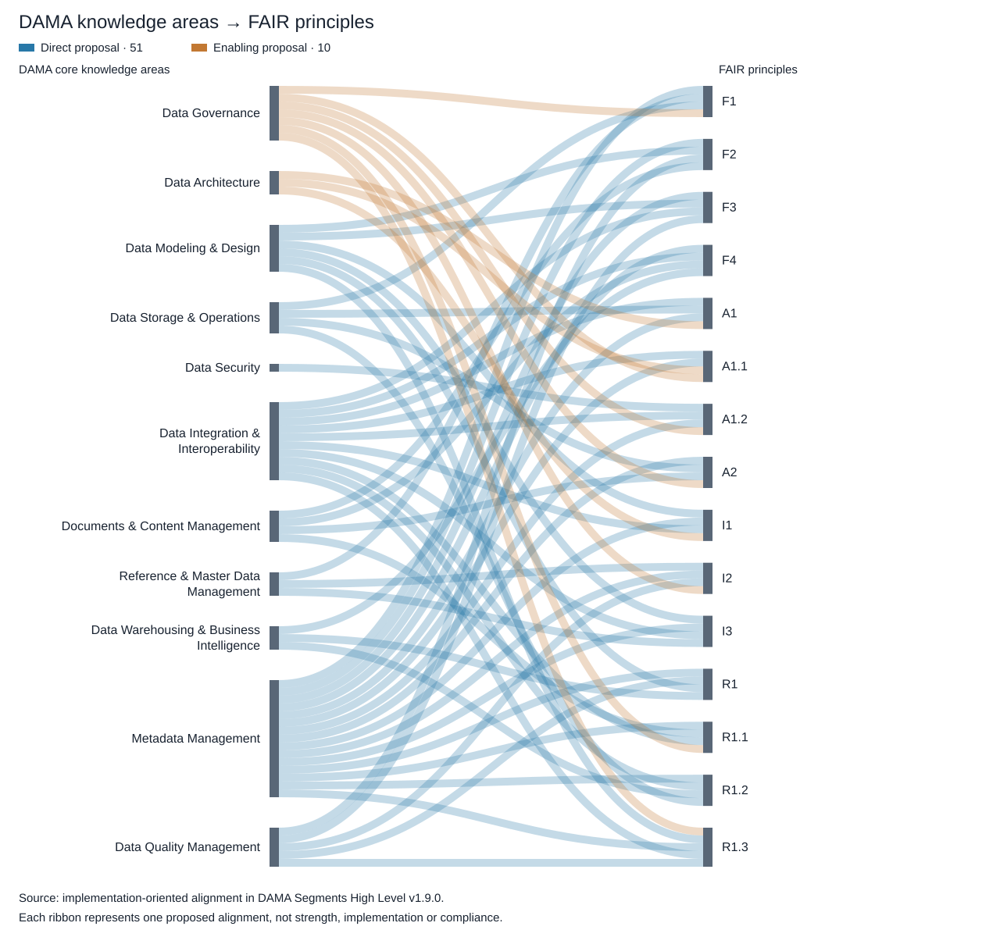

# Overview

> Source: *DAMA Segments — High Level*, v1.17.0, Chris Day. The alignments are potential and proposed; implementation and compliance require supporting evidence. Source DAMA images carry copyright © DAMA International.

**Use DAMA's management disciplines to deliver FAIR outcomes: prioritize the five principles with only indirect alignment, assign accountable owners, and verify implementation against identified data and metadata resources.**

## Situation — DAMA provides the delivery framework for FAIR

DAMA-DMBOK organizes data management into 11 core knowledge areas. FAIR defines 15 principles for making data and metadata findable, accessible, interoperable and reusable. This document connects the two through activity-level mappings, expected deliverables, role descriptions and evidence requirements, providing a basis for incorporating FAIR into existing data management work.

## Complication — Mapped support does not establish implementation

The original ten-segment analysis identified potential direct support for ten FAIR principles, indirect support for four, and no identified support for A1.1. Adding the Data Integration & Interoperability activity analysis extends potential coverage to all 15 principles, but **five still have indirect alignment only**: persistent identifiers (F1), explicit data identifiers in metadata (F3), open retrieval protocols (A1.1), metadata persistence (A2), and data usage licensing (R1.1).

Even the ten directly aligned principles require implementation evidence. The source material also combines an older ten-segment structure with the 11 DMBOK2 knowledge areas, while persona relationships are inferred from area membership rather than confirmed individual accountability. Without explicit requirements, ownership and resource-level tests, broad capability coverage can be mistaken for demonstrated FAIR delivery.

## Question — How can DAMA capabilities become demonstrable FAIR outcomes?

How should the organization turn these potential alignments into a prioritized, accountable implementation program that addresses the five remaining direct-alignment gaps and verifies all 15 FAIR principles?

## Answer — Close the requirements gaps and establish evidence-based delivery

Use the knowledge-area activities as the delivery mechanism, with three priorities:

1. **Specify the missing resource requirements.** Define persistent identifier arrangements, mandatory data identifiers in metadata, open retrieval protocols, metadata survival after data withdrawal, and clear data usage licences. Translate these into concrete deliverables and acceptance criteria.
2. **Assign ownership across the knowledge areas.** Confirm a lead owner and supporting roles for each FAIR requirement, resolve the legacy-to-DMBOK2 activity coverage, and distinguish accountable delivery roles from suppliers and consumers. Use the persona catalog as a starting point for those decisions.
3. **Verify results and sustain improvement.** Test identified data and metadata resources, retain evidence against each principle, and use Data Management Maturity Assessment to prioritize investment and monitor progress. Maturity ratings should complement resource-level evidence.

The resulting program should track each FAIR principle from requirement to activity, owner, deliverable, test and retained evidence. This makes the mapping usable for implementation decisions and subsequent assurance.

The Sankey diagram summarizes the separate **implementation-oriented proposal** across all 11 core knowledge areas: **51 direct and 10 enabling connections** to the 15 FAIR principles. It shows where implementation responsibilities could sit; it does not change the activity-analysis finding that five principles currently have indirect alignment only. Each ribbon represents one proposed mapping, not alignment strength, maturity or compliance. Data Management Maturity Assessment is a supporting discipline and is not an additional core knowledge-area node.

## Document scope and conventions

Duplicate images have been consolidated into eleven blocks. **Activities** corrects the spelling in the requested heading. **Not shown in source** identifies missing sections.

Activity codes: **P — Planning; C — Control; D — Development; O — Operational.**

Version 1.9.0 adds Data Management Maturity Assessment as section 12 from the supplied table. It supports assessment across the knowledge areas and has no assigned FAIR IDs; the principle coverage totals are unchanged.

Version 1.8.0 adds Data Integration & Interoperability as section 11, using the user-supplied table rather than a new workbook extraction. Original ten-segment aggregates remain the historical baseline; the summary and gap update include the additional section.

The overview is numbered **0** for consistency; it is unnumbered in the source. Its **Mission** is retained, and its **Functions** appear under Activities.

FAIR alignment source: DAMA-PDOC_FAIR-MASTER_2026-10-13.xlsx, columns H (direct support) and L (indirect support), from DataGovernance through DataArchitectureManagement. Direct alignment means a specific activity or deliverable can address a FAIR requirement; indirect alignment means an enabling contribution. These are potential alignments, not demonstrated implementation or compliance. IDs are deduplicated within each segment; an ID may occur in both categories across different activities.

Version 1.1.0 adds FAIR Alignment sections. The Data Management overview aggregates the ten segment mappings; it has no separate mapping row in the workbook.
