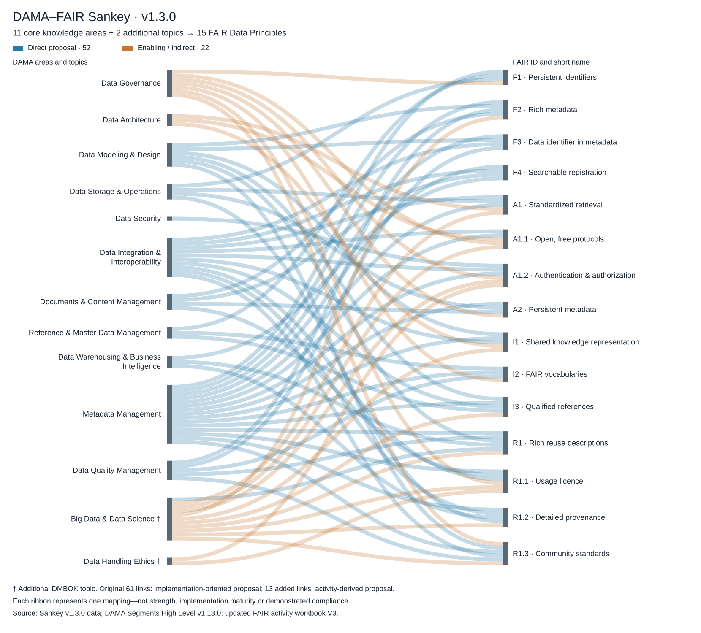

# DAMA and FAIR Alignment

Explore proposed relationships between 11 DAMA core knowledge areas, two additional DMBOK topics (Big Data & Data Science and Data Handling Ethics), and the 15 FAIR Data Principles. The diagram contains 74 mappings: 52 direct, 10 enabling, and 12 indirect. Each ribbon represents one mapping, not alignment strength, implementation maturity, or demonstrated compliance.

[Open the static diagram at full size](assets/dama-fair-sankey_v1.3.0.svg)

The interactive version lets you hover over an area or topic to highlight its connections and select a ribbon to read its rationale and deliverables. Clicking an area or topic opens its individual DAMA segment page. Clicking a FAIR principle opens the matching heading in the 15-principle alignment page.

The interactive diagram loads external scripts from jsDelivr and unpkg. It loads only after you choose **Load interactive diagram** or open it directly.

<button id="load-dama-sankey" type="button">Load interactive diagram</button>

<iframe
  id="dama-sankey-frame"
  title="Interactive DAMA knowledge areas and FAIR principles Sankey diagram"
  width="100%"
  height="1550"
  loading="lazy"
  style="border: 0; display: none;">
</iframe>

[Open the interactive diagram on its own](sankey-v1.3.0.html)

The [text alignment by FAIR principle](../dama/fair-principles.md) is available without loading the interactive diagram.
