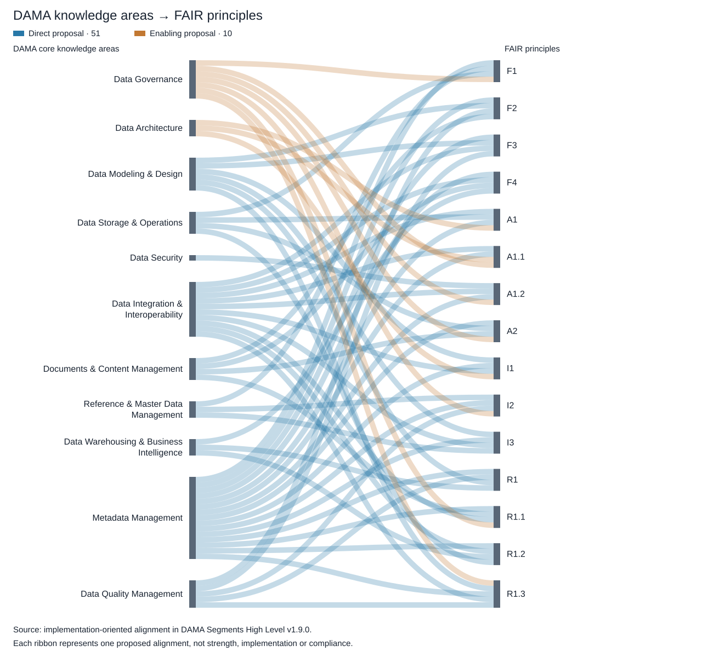

# DAMA and FAIR Alignment

Explore the proposed relationships between the 11 DAMA core knowledge areas and the 15 FAIR Data Principles. The diagram contains 51 direct and 10 enabling proposed mappings. Each ribbon represents one mapping, not alignment strength, implementation maturity, or demonstrated compliance.

The interactive version lets you hover over a knowledge area to highlight its connections and select a ribbon to read its rationale and deliverables. Clicking a knowledge area or FAIR principle opens the corresponding section of the packaged v1.17.0 reading copy in a new tab.

The interactive diagram loads external scripts from jsDelivr and unpkg. It loads only after you choose **Load interactive diagram** or open it directly.

<button id="load-dama-sankey" type="button">Load interactive diagram</button>

<iframe
  id="dama-sankey-frame"
  title="Interactive DAMA knowledge areas and FAIR principles Sankey diagram"
  width="100%"
  height="1350"
  loading="lazy"
  style="border: 0; display: none;">
</iframe>

[Open the interactive diagram on its own](sankey-v1.1.0.html)

The [text alignment by FAIR principle](../dama/fair-principles.md) is available without loading the interactive diagram.
