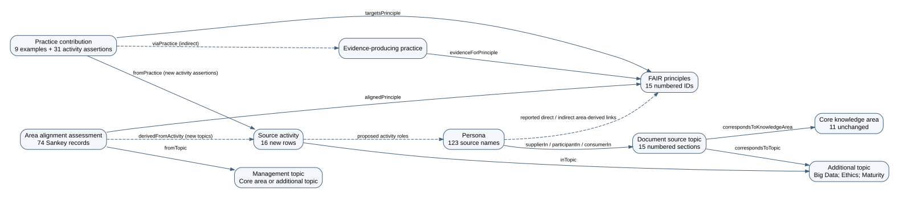

# DAMA and FAIR ontologies

Version: 1.1.0
Author: Chris Day
Updated: 16 November 2026

The DAMA and FAIR ontologies connect management topics, source activities and personas to FAIR principles. This revision incorporates **Big Data & Data Science** and **Data Handling Ethics** from document v1.18.0 and the updated activity workbook, together with the 74-link Sankey v1.3.0 proposal. It preserves the distinction between the 11 core knowledge areas and additional supporting topics.

## Download the Turtle files

| Ontology | What it contains | Download |
|---|---|---|
| DAMA Knowledge Areas and Topics | The unchanged 11-area DMBOK2 enumeration, plus separately classified Big Data & Data Science, Data Handling Ethics and Data Management Maturity Assessment topics. | [DAMA Knowledge Areas and Topics (.ttl)](https://raw.githubusercontent.com/chris-day/FAIR-DAMA/main/artefacts/dama-ontology.ttl) |
| FAIR Vocabulary | The original four FAIR categories and 15 numbered principles. The external vocabulary is retained byte-for-byte. | [FAIR Vocabulary (.ttl)](https://peta-pico.github.io/FAIR-nanopubs/principles/ontology.ttl) |
| DAMA–FAIR Contributions and Assessments | Nine original contribution examples; all 16 new source activities and their 31 proposed practice-level contributions; a separate layer containing the 74 area-level Sankey mappings. | [DAMA–FAIR Contributions (.ttl)](https://raw.githubusercontent.com/chris-day/FAIR-DAMA/main/artefacts/dama-fair-mapping.ttl) |
| DAMA Personas | All 123 names in the v1.18.0 persona catalog, with descriptions, role-category involvement and reported direct/indirect FAIR relationships. | [DAMA Personas (.ttl)](https://raw.githubusercontent.com/chris-day/FAIR-DAMA/main/artefacts/dama-persona-ontology.ttl) |

The project Turtle files are published in this repository's `artefacts/` directory. The FAIR Vocabulary is maintained externally and is unchanged in this revision.

## How the ontologies connect

### Core areas and additional topics

`dama:KnowledgeArea` is a subclass of the broader `dama:ManagementTopic`. `dama:AdditionalTopic` is a separate, disjoint subclass. The core `owl:oneOf` enumeration and the framework's original `dcterms:hasPart` links still contain exactly 11 individuals. `dama:hasAdditionalTopic` links the framework to the three supporting topics without adding them to that enumeration.

Practices associated with core areas retain `map:inKnowledgeArea`. New source activities associated with supporting topics use `map:inTopic`, whose range is the broader class. This avoids accidentally classifying Ethics or Big Data & Data Science as core knowledge areas through property-range inference.

The original source name Data Development has a recorded **partial** correspondence to Data Modeling & Design. It is not an equivalence assertion. Maturity Assessment remains a supporting discipline with no assigned principle IDs. The additional topics are documented in [Big Data & Data Science](dama/segments/13-big-data-data-science.md) and [Data Handling Ethics](dama/segments/14-data-handling-ethics.md).

### Practice-level contributions

The original **six direct and three indirect examples** are retained. The two new topics add **one conditional direct and 30 indirect activity-level assertions**, giving **seven direct and 33 indirect practice contributions** overall. Their source activities preserve worksheet row references, lifecycle codes, proposed role assignments, deliverable associations, rationale and evidence requirements.

Each indirect assertion has an explicit `map:viaPractice` link to a typed practice associated with the same FAIR requirement through `map:evidenceForPrinciple`. These are proposed implementation pathways, not observations that the intermediate practice is already implemented.

Big Data's conditional direct **R1** contribution comes from documented hypotheses and methods linked to the analytical resources. It requires accurate and relevant reuse descriptions. Data Handling Ethics establishes no direct FAIR ID from its supplied diagram; it has conditional indirect **A1.2** and **R1.1** contributions. Ethics training and privacy compliance alone do not establish a FAIR property.

### Area-level Sankey assessments

`map:AreaAlignmentAssessment` preserves all **74** records from Sankey v1.3.0: **52 Direct**, **10 Enabling** and **12 Indirect**. The first 61 records are the broader 11-area implementation proposal; the remaining 13 aggregate the new topic activity mappings. Each record retains its basis and rationale, and new topic records link to their source activities.

These assessments use `map:fromTopic` and `map:alignedPrinciple`, not the practice-contribution properties. Consequently, a broad area-level proposal is not silently treated as an activity-level contribution or dataset evidence. The area-level and practice-level counts are different views and should not be added together. See the [interactive alignment diagram](fair-alignment/index.md) for the area-level view.

### Persona relationships

The catalog preserves **123 unique source names**, including source spelling variants. It records supplier, participant and consumer involvement in the document's 15 numbered source sections. The overall Data Management overview is a source topic, not an additional core knowledge area.

Reported FAIR links are taken exactly from the v1.18.0 persona table. They are unions of the FAIR mappings of the person's listed areas, not confirmed responsibility assignments. Proposed activity-level roles are represented separately by `map:proposedResponsiblePersona`, `map:proposedApprovingPersona` and `map:proposedContributingPersona`. See the [persona catalog](dama/personas.md).

## Validation and reproducibility

The [v1.1.0 ontology archive](https://github.com/chris-day/FAIR-DAMA/blob/main/artefacts/DAMA_FAIR_Ontologies_v1.1.0.zip) contains its builder, offline validator, input manifest and a report of **1,062 passed checks**. Those checks cover RDF parsing, structural invariants, persona and workbook fidelity, the original contribution examples, all 74 Sankey records and cross-module SPARQL joins. The standalone validator also requires the source workspace described in the archive README; the report is supplied for review with the archive. Validation does not fetch remote imports or establish complete OWL consistency or operational FAIR compliance.

The published Turtle files correct source URLs in the archive to this repository's `artefacts/DAMAV2Images/` and `artefacts/` paths. These provenance URL corrections change the bytes of two Turtle files without changing their contribution or classification assertions.

## Load the ontologies together

Load all four Turtle files into one RDF dataset. For the three project ontologies, the GitHub file page URL is the ontology IRI and the same URL followed by `#` is the term namespace. FAIR identifiers retain `https://w3id.org/fair/principles/terms/`. This revision labels the three project ontology modules with `owl:versionInfo "1.1.0"`.

The project ontologies credit Chris Day as creator. [ORCID 0000-0001-5095-7052](https://orcid.org/0000-0001-5095-7052)
