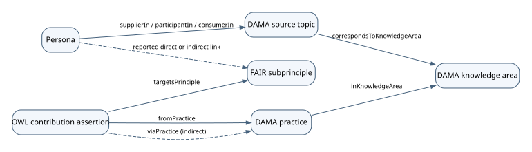

# Ontologies

The DAMA and FAIR ontologies connect data management knowledge areas, practices and personas to specific FAIR principles. The FAIR Vocabulary supplies the principle identifiers. Three project ontologies describe the DAMA areas, proposed practice-level contributions and persona relationships.

## Download the Turtle files

| Ontology | What it contains | Download |
|---|---|---|
| DAMA Knowledge Areas | The 11 DAMA-DMBOK2 knowledge areas, with their names and definitions. The framework links to each area using `dcterms:hasPart`. | [DAMA Knowledge Areas (.ttl)](https://raw.githubusercontent.com/chris-day/FAIR-DAMA/main/artefacts/dama-ontology.ttl) |
| FAIR Vocabulary | The four FAIR principles and their 15 numbered subprinciples, organised using `dcterms:hasPart`. | [FAIR Vocabulary (.ttl)](https://peta-pico.github.io/FAIR-nanopubs/principles/ontology.ttl) |
| DAMA–FAIR Contributions | Named DAMA practices and OWL assertions describing six direct and three indirect contributions to FAIR subprinciples. | [DAMA–FAIR Contributions (.ttl)](https://raw.githubusercontent.com/chris-day/FAIR-DAMA/main/artefacts/dama-fair-mapping.ttl) |
| DAMA Personas | The 108 entries in the published persona table, including descriptions, involvement in DAMA topics and reported FAIR relationships. | [DAMA Personas (.ttl)](https://raw.githubusercontent.com/chris-day/FAIR-DAMA/main/artefacts/dama-persona-ontology.ttl) |

## How the ontologies connect

**Practice-level contributions.** Each assertion identifies a DAMA practice and a FAIR subprinciple, with a rationale, source and any applicability condition. A direct contribution produces or verifies evidence relevant to the subprinciple. An indirect contribution names the intermediate practice that provides or verifies that evidence. For example, publishing detailed dataset provenance directly supports FAIR **R1.2**. Assigning responsibility for documenting provenance supports **R1.2** indirectly through that publishing practice. These assertions describe contributions. A dataset assessment would also need evidence from the dataset or its metadata.

**Persona relationships.** A persona can be a supplier, participant or consumer in one or more topics. The ontology preserves the table’s topic names and links them to DAMA knowledge areas where a correspondence has been recorded. It also preserves the table’s direct and indirect FAIR links as reported relationships. The table does not identify the intermediate practices behind those indirect links, so these relationships are represented separately from practice-level contribution assertions. [Published persona table](https://fair-dama.perdl.com/dama/personas/)

## Load the ontologies together

Download all four Turtle files and load them into the same RDF dataset to query across the shared identifiers. For the three project ontologies, the GitHub file page URL is the ontology IRI, and the same URL followed by `#` is the term namespace. The raw GitHub URLs in the table serve the Turtle files. FAIR terms retain their original namespace, `https://w3id.org/fair/principles/terms/`.

The three project ontologies credit Chris Day as creator. [ORCID 0000-0001-5095-7052](https://orcid.org/0000-0001-5095-7052)
